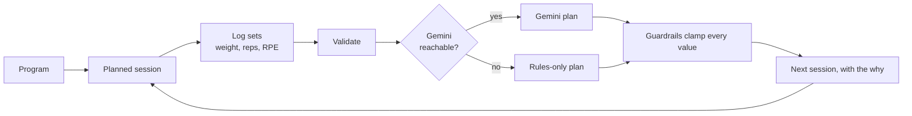

<div align="center">

<picture>
  <source media="(prefers-color-scheme: dark)" srcset="./Design/coaching-app/design-system/assets/Logos/coaching-app-lockup-inverse.svg">
  
</picture>

<br><br>

**Log your sets. Get the next session planned, with the reason why.**

A personal Android app to track gym progress. After each session, Gemini and your own rules plan the next one (weights, reps, sets) and explain the change.

<br>


[Overview](#overview) &nbsp;·&nbsp; [How it works](#how-it-works) &nbsp;·&nbsp; [Features](#features) &nbsp;·&nbsp; [Progression rules](#progression-rules) &nbsp;·&nbsp; [Screens](#screens) &nbsp;·&nbsp; [Design](#design) &nbsp;·&nbsp; [Roadmap](#roadmap) &nbsp;·&nbsp; [Repository](#repository)

</div>

<br>

> **Status: design phase. No code yet.** Vocabulary lives in [CONTEXT.md](./CONTEXT.md), progression rules in [RULES.md](./RULES.md), decisions in [docs/adr](./docs/adr), and the work is tracked in the [issues](https://github.com/Adrien-EPF/Coaching_App/issues).

<br>

## Overview

Deciding the weight, reps and sets for every exercise from your past performance is tedious and inconsistent. And most trackers only store numbers: they do not tell you what to lift next, or why.

Coaching App is built for one lifter, in the gym, often without signal:

- **It plans for you.** One Gemini call per validated session proposes the next session, guided by your rules and your last 6 sessions per exercise.
- **It stays safe.** Hard Guardrails clamp every value, whatever Gemini says. If Gemini fails, a rules-only plan takes over.
- **It explains.** A short "why this weight" appears only when the weight changes.
- **It works offline.** Data lives on the phone. The plan is already loaded before you walk in.
- **It aims at performance only.** More load, more reps. Never appearance.

<br>

## How it works

| | Step | What happens |
|:-:|---|---|
| **1** | **Program** | A training plan with a cycle of 1 week (default), 2 weeks or 1 month. Sessions are placed on calendar days, each made of exercises with a prescribed number of sets. |
| **2** | **Starting a Program** | Enter your known weights by hand (Initial Weights), run a Gemini-planned Test Session, or let Gemini propose Starting Estimates from related movements, taking the exercise's position in the session into account. |
| **3** | **In the gym** | The session is already planned. For each set you log weight, reps and RPE, with planned values pre-filled and last session's numbers shown beside them. Skipped sets or exercises are marked "Not completed". |
| **4** | **Validation** | Once every set is logged or marked not completed, you validate the session. This triggers one Gemini call that plans the next session. |
| **5** | **The plan** | Gemini receives the last 6 sessions per exercise, your Rules, your Objectives and any Problem Report, and returns structured JSON. Every value is clamped by the Guardrails. If Gemini is unreachable, a rules-only plan is used. |
| **6** | **Explanations** | A short "why this weight" appears only when the weight changes from last time, plus one line for the whole session. |
| **7** | **Calendar** | You can skip, move or add unplanned sessions, and mark rest days and injuries. Missed sessions do not shift the program. A Problem Report (e.g. bad sleep) on an upcoming session re-plans it. |
| **8** | **Dashboard** | PRs at each rep count, Estimated 1RM (Epley, on the lifted weight only, never bodyweight), Objectives (a target PR with a date), and adherence. Trend charts come right after v1. |



<br>

## Features

### Programs and calendar

- **Cycles of 1 week, 2 weeks or 1 month.** Your real training structure, not a forced template.
- **Sessions on calendar days**, each made of exercises with a prescribed number of sets and one Training Goal per exercise.
- **Skip, move or add** sessions. Log an **Unplanned Session** when you train outside the program.
- **Rest days and injuries** are marked, so gaps are explained.
- **Missed sessions** are marked as missed. The program never shifts: your weekly routine stays fixed.
- **Stable exercise identity.** Renaming an exercise does not break its history.
- **Bodyweight and weighted versions are two exercises** (pull-up and weighted pull-up), each with its own progression.

### In the gym

- **Fast set entry.** Weight, reps and RPE per set, with the planned values pre-filled and last session's numbers beside them.
- **An RPE scale on screen** every time you enter one, so your notes stay consistent from one month to the next.
- **Not completed** on a set or a whole exercise, so skips are recorded honestly.
- **Validation** is possible only once every set is logged or not completed, so the next plan rests on complete data.
- **Frozen history.** Validated sessions are read-only. Editing one later re-plans the next session.
- **Dark theme** for evenings in the gym.

### Planning

- **One Gemini call per validated session.** No per-set calls: the free tier is enough, and no connection is needed in the gym.
- **Position-aware.** An exercise placed last can stay at the same load if fatigue explains missed reps.
- **Context-aware.** Gemini sees your Objectives and any Problem Report, and can hold or lower a load, never raise it, when you report bad sleep or pain.
- **Test Session and Starting Estimates** for exercises with no history: Gemini scales a new program to your level, and you approve or edit the proposal.
- **Initial Weights.** The one place where you set weights yourself, when you already know your levels.
- **Always a plan.** If Gemini is unreachable or returns something malformed, a deterministic rules-only plan is used and flagged as such.
- **Nothing to edit by hand in a plan.** The Rules decide, within the Guardrails.

### Dashboard

- **Personal Records** at each rep count, per exercise.
- **Estimated 1RM** with the Epley formula, on the lifted weight only. For a weighted pull-up, that is the added load, never your bodyweight.
- **Objectives**: a target PR with a date (e.g. weighted pull-up, 5 reps at +10 kg by March), with progress against your current PR. Objectives guide Gemini but never push a plan past the Guardrails.
- **Adherence**: sessions done versus planned, per month and per year.

### Your data

- **Local only.** SQLite on the device. No account, no backend.
- **Export** everything as JSON (full fidelity, re-importable) or CSV. A lost phone should not lose your history.
- **Private by design.** Gemini prompts contain no personal identifiers, and the API key stays on the device.

<br>

## Progression rules

The full rules live in [RULES.md](./RULES.md), as readable principles plus one versioned config block the app reads. Each exercise has a **Training Goal**; the shared rules apply to all, then the goal's own rules.

### The model: double progression

1. Work inside a rep range (for example 3 to 5).
2. While not every set reaches the top of the range, keep the load and aim for +1 rep on the sets that fall short.
3. When every set reaches the top, raise the load and restart from the bottom of the range.

A session counts as a success for an exercise only when **all** its sets reach the top. A set marked not completed counts as not successful.

### By Training Goal

| | Strength | Hypertrophy | Endurance |
|---|:-:|:-:|:-:|
| **Reps** | 1 to 5 | 6 to 10 | 12 to 20 |
| **Default window** | 3 to 5 | | |
| **Sets** | 4 to 6 | 3 | 2 to 3 |
| **Load step** | +5 % | +2,5 % | +2,5 % |
| **Max RPE to raise load** | 9 | 9 | no brake |
| **Raise load when** | all sets at top | all sets at top | all sets at 20 reps |

Hypertrophy here means building muscle to lift more later. Appearance never enters the rules.

### RPE is a brake

Reps reached at too high an RPE (above the goal's maximum, on any set) do **not** raise the load. The load stays until the same reps pass under that RPE. Endurance is the exception: those sets are meant to go close to failure.

| RPE | Meaning |
|:-:|---|
| **10** | No rep left |
| **9,5** | Maybe one more rep |
| **9** | 1 more rep possible |
| **8,5** | Maybe 2 more reps |
| **8** | 2 more reps possible |
| **7** | 3 more reps possible |
| **6 or less** | 4 or more reps left, light effort |

### Two examples

| Situation | Result |
|---|---|
| **Hypertrophy**, dumbbell press at 20 kg, 3 sets of 6 to 10. All sets reach 10 reps, RPE 8,5. | +2,5 % is 0,5 kg, below the 2 kg dumbbell step, so the load goes to **22 kg** and reps restart from 6. |
| **Strength**, squat. A set falls below the bottom of the range twice in a row at the same load. | The first failure keeps the load and retries. The second one drops the load by **10 %**, rounded to the available load, and reps restart from the bottom. |

### Failure, pauses and special cases

- **Failure** is at least one set under the bottom of the range. First failure: retry at the same load. Second consecutive failure: -10 %.
- **No scheduled deload.** The load only goes down on failure or after a break.
- **After a break**, measured from the last time you did that exercise: under 2 weeks, same load; 2 to 4 weeks, -10 %; over 4 weeks, -20 %.
- **Range overshoot.** If the first set beats the top of the range by 2 reps or more, the load was too light: the new load comes from the Estimated 1RM, capped at +10 %.
- **Bodyweight exercises** without added load: aim for +1 rep per set every session, with no cap.
- **Goal change.** When an exercise moves to another Training Goal, the starting load comes from the Estimated 1RM for the bottom of the new range, minus a 10 % margin.
- **Unplanned sessions** inform Gemini (fatigue, PRs) but never trigger a raise or a failure.

### Guardrails

Hard limits applied after Gemini, whatever it answers. Out-of-range values are clamped and you are warned.

| Limit | Value |
|---|---|
| **Max increase** | +10 % per session and per exercise (or the smallest increment if +10 % is below it) |
| **Max decrease** | -10 %, or -20 % after a break of more than 4 weeks |
| **Reps and sets** | Always inside the Training Goal's bounds |
| **Exceptions** | The starting load after a goal change, and uncapped reps on unweighted bodyweight exercises |
| **Fallback** | Rules-only plan if Gemini fails |

### Equipment and increments

Recommendations are always loadable on real equipment.

| Equipment | Smallest step |
|---|---|
| **Weight belt** (personal plates: 1, 2,5, 5, 10, 20 kg) | 1 kg, capped at 100 kg |
| **Barbell** (Basic-Fit) | 2 kg |
| **Dumbbells** (Basic-Fit) | 2 kg |
| **Guided machines** (Basic-Fit) | 2 kg, nearest available load |
| **Cables** (Basic-Fit) | 2 kg, nearest available load |

When the smallest step is larger than the planned percentage, double progression absorbs the gap: the load goes up and the reps restart from the bottom of the range.

<br>

## Screens

Thirteen screens are designed, in French, in [`Design/coaching-app/screens`](./Design/coaching-app/screens).

| Screen | Purpose | Issue |
|---|---|:-:|
| **Aujourd'hui** | Today's session and the way into everything else | [#2](https://github.com/Adrien-EPF/Coaching_App/issues/2) |
| **Programme** | The active program and its upcoming sessions | [#3](https://github.com/Adrien-EPF/Coaching_App/issues/3) |
| **Calendrier** | Skip, move, add, rest days, injuries, missed sessions | [#3](https://github.com/Adrien-EPF/Coaching_App/issues/3) |
| **Démarrer un programme** | Initial Weights, Test Session, Starting Estimates | [#7](https://github.com/Adrien-EPF/Coaching_App/issues/7) |
| **Séance en cours** | The planned session, exercise by exercise (light and dark) | [#4](https://github.com/Adrien-EPF/Coaching_App/issues/4) |
| **Saisir une série** | Weight, reps and RPE, with the RPE scale | [#4](https://github.com/Adrien-EPF/Coaching_App/issues/4) |
| **Séance validée** | Validation of a finished session | [#4](https://github.com/Adrien-EPF/Coaching_App/issues/4) |
| **Signaler un problème** | Problem Report on an upcoming session | [#8](https://github.com/Adrien-EPF/Coaching_App/issues/8) |
| **Progrès** | PRs, Estimated 1RM, Objectives, adherence | [#9](https://github.com/Adrien-EPF/Coaching_App/issues/9), [#10](https://github.com/Adrien-EPF/Coaching_App/issues/10), [#11](https://github.com/Adrien-EPF/Coaching_App/issues/11) |
| **Réglages** | Export CSV and JSON, import | [#12](https://github.com/Adrien-EPF/Coaching_App/issues/12) |

<br>

## Design

Bold and athletic: a scoreboard of big condensed numbers on calm grounds, with one electric-lime accent that means *go*. The UI is in French, light first, with a full dark theme (*Sombre*).


| | |
|---|---|
| **Type** | Sofia Sans Condensed for everything read at arm's length (numbers, titles, labels, buttons), Barlow for sentences. One hero number per screen. |
| **Color** | Lime is a fill that means go: the main action, today's session, an increase. Inverted ink slabs mean selected. Each Training Goal has its own color, always paired with its label. |
| **States** | Failure, missed and decrease use the danger color. A clamped value or a Problem Report uses the warning color. Every state also carries a word or a glyph, never color alone. |
| **Shape** | Borders instead of shadows, medium corners, tap targets of at least 48 px, the main action within thumb reach. |
| **Voice** | Plain, to *tu*, reason first: « RPE 9,5 sur la dernière série : on garde la charge. » No hype, no emoji. |

**Components:** Button, GoalBadge, SessionStatus, SetRow, RpePicker, ExerciseCard, RecommendationNote, PrStat.

Everything lives in [`Design/coaching-app`](./Design/coaching-app): the [design system](./Design/coaching-app/design-system) (tokens, components, fonts, logos; its [README](./Design/coaching-app/design-system/README.md) holds the full content and visual rules) and the [screens](./Design/coaching-app/screens).

<br>

## Architecture

| | |
|---|---|
| **Platform** | Native Android app (Expo / React Native, TypeScript), built to an APK by a GitHub Action. |
| **Data** | Local only (SQLite on the device), with JSON and CSV export. |
| **Gemini** | Free API key stored on the device, one call per validated session. |
| **Rules** | One versioned config file (structured rules, free-text principles, available increments), written separately with Claude Desktop. |
| **History** | Past sessions are frozen; program edits only apply going forward. |

**Planning engine.** The core module takes each exercise's history (last 6 sessions), the Rules, Objectives, Problem Reports and exercise positions, and returns a Session Plan: weight, reps and sets per exercise, a reason only where the weight changed, and a one-line session summary. Gemini sits behind an interface and must return structured JSON, which is validated before use. Guardrails are applied after Gemini.

**Why these choices** are written down in [docs/adr](./docs/adr/0001-local-data-and-gemini-with-guardrails.md): local-only data (single user, no account, export as the safety net), Gemini that decides rather than only explains (a bad answer is made impossible by Guardrails, not unlikely), and one call per validated session to stay within the free tier.

**Testing.** Tests check external behavior only: given a history, the Rules and a fake Gemini response, which plan comes back. The planning engine is the single seam, with Gemini replaced by a fake. It covers Guardrail clamping, malformed Gemini output, fallback to rules-only and position-in-session inputs. Everything else is verified through end-to-end flows on the running app.

<br>

## Roadmap

Work is tracked as issues, each one a thin end-to-end slice. Later slices depend on earlier ones.

| | Slice | After |
|:-:|---|:-:|
| [#2](https://github.com/Adrien-EPF/Coaching_App/issues/2) | App skeleton and APK build | |
| [#3](https://github.com/Adrien-EPF/Coaching_App/issues/3) | Program, Cycle and calendar | #2 |
| [#4](https://github.com/Adrien-EPF/Coaching_App/issues/4) | Session logging and Validation | #3 |
| [#5](https://github.com/Adrien-EPF/Coaching_App/issues/5) | Rules config and offline rules-only planner | #4 |
| [#6](https://github.com/Adrien-EPF/Coaching_App/issues/6) | Gemini Session Plan with Guardrails | #5 |
| [#7](https://github.com/Adrien-EPF/Coaching_App/issues/7) | Initial Weights, Test Session and Starting Estimates | #6 |
| [#8](https://github.com/Adrien-EPF/Coaching_App/issues/8) | Problem Report and re-planning | #6 |
| [#9](https://github.com/Adrien-EPF/Coaching_App/issues/9) | Personal Records and Estimated 1RM | #4 |
| [#10](https://github.com/Adrien-EPF/Coaching_App/issues/10) | Objectives | #9 |
| [#11](https://github.com/Adrien-EPF/Coaching_App/issues/11) | Adherence | #3, #4 |
| [#12](https://github.com/Adrien-EPF/Coaching_App/issues/12) | Export and import | #4 |

The parent spec is [#1](https://github.com/Adrien-EPF/Coaching_App/issues/1), with the full list of 33 user stories.

### Out of scope for v1

Trend charts, volume and frequency objectives, rest timer, bodyweight tracking, automatic evening-before planning, cloud sync and accounts, iOS.

<br>

## Setup

The Gemini key is free and stays on your device.

1. Get a key at [Google AI Studio](https://aistudio.google.com/apikey).
2. Copy `.env.example` to `.env` and put the key after `EXPO_PUBLIC_GEMINI_API_KEY=`. `.env` is git-ignored.
3. The app reads a key entered in its settings first (kept in the device's secure storage), then falls back to `.env`. See [`src/config/geminiKey.ts`](./src/config/geminiKey.ts).

A key set in `.env` is built into the APK, which is fine for a free key in a personal app. Do not share the APK.

<br>

## Repository

```text
.
├── README.md        this file
├── CONTEXT.md       the domain vocabulary
├── RULES.md         progression rules and Guardrails (the config the app reads)
├── docs/adr/        architecture decisions
├── Design/
│   └── coaching-app/
│       ├── design-system/   tokens, components, fonts, logos
│       └── screens/         the 13 designed screens
├── src/config/      Gemini key loading
└── .env.example     template for your local .env
```

<details>
<summary><b>Glossary</b></summary>

<br>

| Term | Meaning |
|---|---|
| **Program** | A named training plan made of Sessions laid out over a Cycle. |
| **Cycle** | The repeating span of a Program: 1 week (default), 2 weeks or 1 month. |
| **Session** | One planned workout on a calendar day, made of Exercises. |
| **Exercise** | A movement in a Session, with a number of Sets and one Training Goal. |
| **Training Goal** | Strength, Hypertrophy or Endurance. Decides which Rules drive an Exercise. |
| **Set** | One logged effort: weight, reps and RPE. |
| **RPE** | Rate of Perceived Exertion, 1 to 10, logged on each Set. In the Rules it acts as a brake. |
| **Rules** | The progression rules, one set per Training Goal plus shared rules. |
| **Recommendation** | The weight, reps and sets proposed for an Exercise, with an explanation. |
| **Session Plan** | All Recommendations for one Session, generated in one go. |
| **Guardrail** | A hard limit that clamps any Recommendation, whatever Gemini says. |
| **Validation** | Closing a finished Session. It triggers the next Session Plan. |
| **Not Completed** | A Set or Exercise you skipped. |
| **Problem Report** | A note on an upcoming Session (e.g. bad sleep) passed to Gemini. |
| **Initial Weights** | Weights you enter by hand when creating a Program. |
| **Starting Estimate** | A proposed weight for an Exercise with no history. |
| **Test Session** | An optional Gemini-planned Session to measure your level. |
| **Personal Record (PR)** | Your heaviest weight at each rep count for an Exercise. |
| **Estimated 1RM** | A one-rep-max estimate on the lifted weight only. |
| **Objective** | A target PR with a date. |
| **Missed Session** | A planned Session you did not do. The Program does not shift. |
| **Unplanned Session** | A Session logged outside the Program. |

</details>
